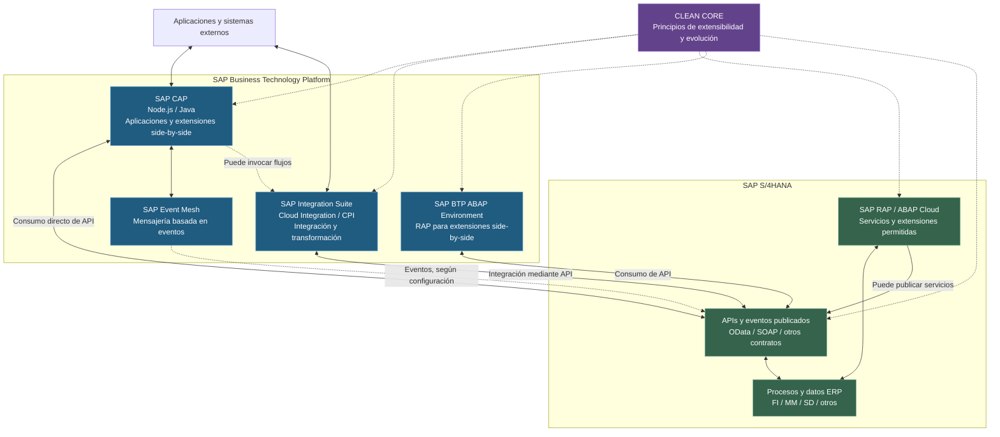
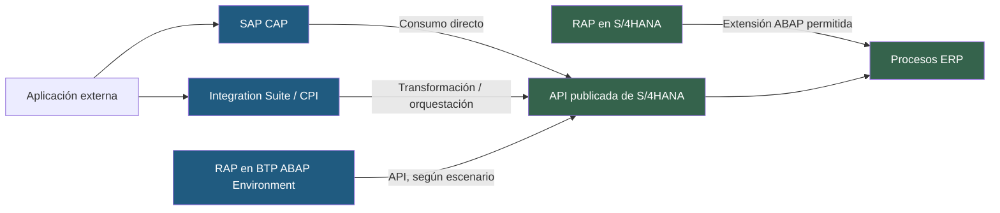

# 00 - Mapa conceptual del ecosistema SAP

**Proyecto:** SAP Clean Core Learning Lab
**Estado:** ⬜ `Pendiente`
**Propósito:** comprender cómo se relacionan SAP S/4HANA, SAP BTP, CAP, RAP, Integration Suite y los principios Clean Core.

## 1. Objetivo

Identificar las responsabilidades de cada tecnología y distinguir entre una **extensión de negocio**, una **integración entre sistemas** y una **modificación del núcleo ERP**. Al finalizar, deberíamos poder justificar cuándo consumir una API directamente y cuándo incorporar una capa de integración.

## 2. Mapa conceptual general

> **Alcance del diagrama:** representa relaciones posibles, no un despliegue obligatorio. La exposición de APIs y eventos, las autorizaciones y la conectividad dependen de la edición y configuración de S/4HANA. La flecha de Event Mesh representa un flujo conceptual: la entrega real de eventos puede requerir servicios y configuración adicionales.

## 3. Responsabilidades

| Elemento | Responsabilidad principal | Aclaración |
|---|---|---|
| **SAP S/4HANA** | ERP que ejecuta procesos empresariales | No es lo mismo que la base de datos SAP HANA. |
| **SAP BTP** | Plataforma para construir, integrar y operar soluciones | Agrupa múltiples servicios, no una única herramienta. |
| **SAP CAP** | Framework de desarrollo de servicios y aplicaciones con Node.js o Java | Puede consumir APIs de S/4HANA directamente. |
| **SAP RAP** | Modelo de programación ABAP para aplicaciones y servicios transaccionales | Puede utilizarse en S/4HANA y en SAP BTP ABAP Environment, según las capacidades del entorno. |
| **SAP Integration Suite** | Plataforma de integración de aplicaciones, APIs y procesos | Cloud Integration (CPI) es una de sus capacidades. |
| **SAP Event Mesh** | Mensajería orientada a eventos | No es un sustituto universal de Integration Suite. |
| **Clean Core** | Enfoque para preservar la capacidad de actualización y evolución del ERP | No exige que todo acceso pase por CPI. |

## 4. Rutas de interacción

### Ruta A - CAP → API de S/4HANA

Adecuada cuando una aplicación o extensión necesita consultar o actualizar información empresarial mediante un contrato disponible y autorizado. **No necesita obligatoriamente un iFlow**. Deben resolverse autenticación, conectividad, permisos, errores y compatibilidad del contrato.

### Ruta B - Sistema externo → Integration Suite → API de S/4HANA

Adecuada cuando existe necesidad de transformación, enrutamiento, mediación de protocolos, coordinación de múltiples sistemas o monitoreo centralizado de una integración. Incorporar CPI no es obligatorio si no aporta una capacidad necesaria.

### Ruta C - RAP en S/4HANA

Permite construir aplicaciones y servicios ABAP dentro de los mecanismos admitidos por el entorno. La compatibilidad con Clean Core depende de utilizar los objetos, contratos y puntos de extensión permitidos; **usar RAP por sí solo no garantiza Clean Core**.

### Ruta D - RAP en SAP BTP ABAP Environment

Permite desarrollar una extensión ABAP **side-by-side**, fuera del runtime del ERP, que puede comunicarse con S/4HANA a través de APIs y conectividad configuradas. RAP, por tanto, no está limitado al interior de S/4HANA.

## 5. Criterios para elegir la arquitectura

| Pregunta | Orientación inicial |
|---|---|
| ¿Solo necesito consumir una API empresarial desde una extensión? | Evaluar primero el acceso directo desde CAP o desde el componente que corresponda. |
| ¿Necesito transformar mensajes o conectar varios sistemas? | Evaluar Integration Suite. |
| ¿Necesito lógica transaccional ABAP cercana al modelo del ERP? | Evaluar RAP y las capacidades de extensibilidad del S/4HANA concreto. |
| ¿Necesito desarrollar una extensión ABAP separada del ERP? | Evaluar SAP BTP ABAP Environment con RAP. |
| ¿Necesito publicar o consumir eventos? | Evaluar los eventos disponibles, Event Mesh y los requisitos de entrega y procesamiento. |
| ¿La solución respeta Clean Core? | Verificar uso de APIs/objetos liberados, acoplamiento, mantenibilidad y compatibilidad con actualizaciones. |

Estas orientaciones no sustituyen una evaluación de arquitectura, licenciamiento, conectividad, seguridad y requisitos no funcionales.

## 6. Relación con nuestro perfil profesional

Nuestro objetivo es desarrollar competencias como **Ingeniero de Integración y Desarrollo SAP BTP**, con foco en integraciones y extensiones side-by-side bajo principios Clean Core.

- **Integration Suite / CPI:** práctica profunda de integración, seguridad, transformación, monitoreo y errores.
- **CAP / Node.js:** práctica de desarrollo backend y extensiones.
- **Clean Core:** criterios de diseño, límites y mecanismos de extensibilidad.
- **RAP / ABAP Cloud:** comprensión de su rol y de cuándo conviene utilizarlo; no implica formación inicial completa como desarrollador ABAP.

## 7. Actividad de validación propuesta

1. Describir un caso de consulta de pedidos desde una aplicación CAP.
2. Dibujar dos alternativas: **CAP → API S/4HANA** y **CAP → Integration Suite → API S/4HANA**.
3. Explicar qué problema concreto justificaría agregar Integration Suite.
4. Identificar cuándo RAP sería una alternativa y distinguir su ejecución en S/4HANA frente a BTP ABAP Environment.
5. Documentar qué información falta para confirmar el cumplimiento de Clean Core en cada alternativa.

**Criterio de completitud:** explicar las diferencias sin confundir CAP, RAP, CPI, BTP y S/4HANA, y justificar la elección arquitectónica en un escenario concreto. La actividad aún no ha sido ejecutada.

## 8. Referencias oficiales para profundizar

- [SAP Clean Core - SAP](https://www.sap.com/products/erp/rise/clean-core.html)
- [SAP Cloud Application Programming Model](https://cap.cloud.sap/docs/)
- [ABAP RESTful Application Programming Model - SAP Help](https://help.sap.com/docs/abap-cloud/abap-rap)
- [SAP Integration Suite - SAP Help](https://help.sap.com/docs/integration-suite)
- [SAP Business Technology Platform - SAP Help](https://help.sap.com/docs/btp)

## 9. Control de cambios

| Fecha | Versión | Cambio | Motivo |
|---|---|---|---|
| 2026-10-26 | 0.1.0 | Creación del mapa conceptual y rutas CAP, CPI y RAP | Material de referencia inicial para Clean Core Learning Lab |

---

**Estado del tema:** ⬜ `Pendiente` - documento preparado; validación práctica pendiente.
